# AWS Site-to-Site VPN with Libreswan

> A hands-on, static-routing lab that connects two isolated VPCs through an EC2-hosted Libreswan IPsec router.

  

## What this project demonstrates

This project connects a private workload in an AWS VPC in **Mumbai (`ap-south-1`)** to a simulated on-premises network in **N. Virginia (`us-east-1`)**. An EC2 instance in the simulated datacenter runs Libreswan and acts as the customer gateway device. AWS Site-to-Site VPN provides the other endpoint.

The lab uses static routes and a single Libreswan tunnel. The captured result shows Tunnel 1 **Up**, Tunnel 2 **Down**, and successful SSH and ICMP traffic between the private networks. This proves the path works; it is **not a highly available VPN design**.

## Architecture

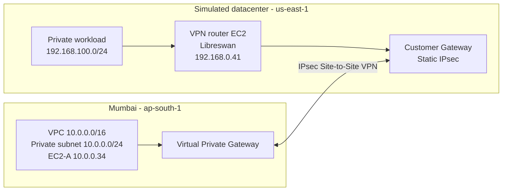

> **Addressing note:** The supplied exercise uses `192.168.0.0/16` as the simulated datacenter VPC CIDR. The VPN router is shown as `192.168.0.41`; the private test host is shown as `192.168.100.106`. Use your own allocated addresses and verify the actual subnet CIDRs in your account before applying routes.

| Component | Region | Example CIDR / address | Role |
|---|---|---:|---|
| AWS workload VPC | Mumbai, `ap-south-1` | `10.0.0.0/16` | Cloud-side network |
| AWS private subnet | Mumbai | `10.0.0.0/24` | Hosts EC2-A (`10.0.0.34`) |
| Simulated datacenter VPC | N. Virginia, `us-east-1` | `192.168.0.0/16` | Customer-side network |
| Simulated private subnet | N. Virginia | `192.168.100.0/24` | Hosts EC2-B (`192.168.100.106`) |
| VPN router EC2 | N. Virginia | `192.168.0.41` (private) | Libreswan customer gateway device |
| Customer gateway address | N. Virginia | Router's reachable public IPv4 | Public endpoint registered in AWS |

**Replace all example values** with your own VPC, subnet, router, and tunnel values. VPC CIDRs must not overlap. A customer gateway IP must be stable and reachable from the internet; for a persistent lab, associate an Elastic IP with the VPN router and use that address when creating the AWS Customer Gateway.

## Prerequisites

- An AWS account with permissions for VPC, EC2, and Site-to-Site VPN resources in both regions.
- Two non-overlapping IPv4 CIDR ranges.
- A key pair or another secure way to reach the instances.
- Security groups and network ACLs that allow only the traffic needed for your test.
- Budget awareness: EC2 instances, public IPv4 addresses, and Site-to-Site VPN can incur charges while provisioned.

## Build the lab

### 1. Create the AWS workload VPC (Mumbai)

In the AWS console, switch to **Asia Pacific (Mumbai), `ap-south-1`**.

1. Create a VPC named `AWS-VPC` with IPv4 CIDR `10.0.0.0/16`.
2. Create a private subnet such as `10.0.0.0/24` in one Availability Zone.
3. Create a route table for the private subnet and associate the subnet with it.
4. Launch **EC2-A** in that subnet with no public IPv4 address. The captured example used `10.0.0.34`.
5. Create or update the EC2-A security group to allow the test traffic from the simulated datacenter CIDR (for example, ICMP and SSH from `192.168.0.0/16`, as needed). Permit corresponding return traffic through the stateful security group.

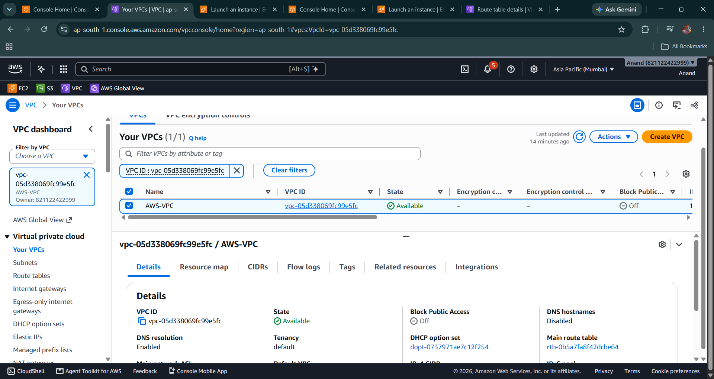
*Figure 1. AWS workload VPC in Mumbai.*

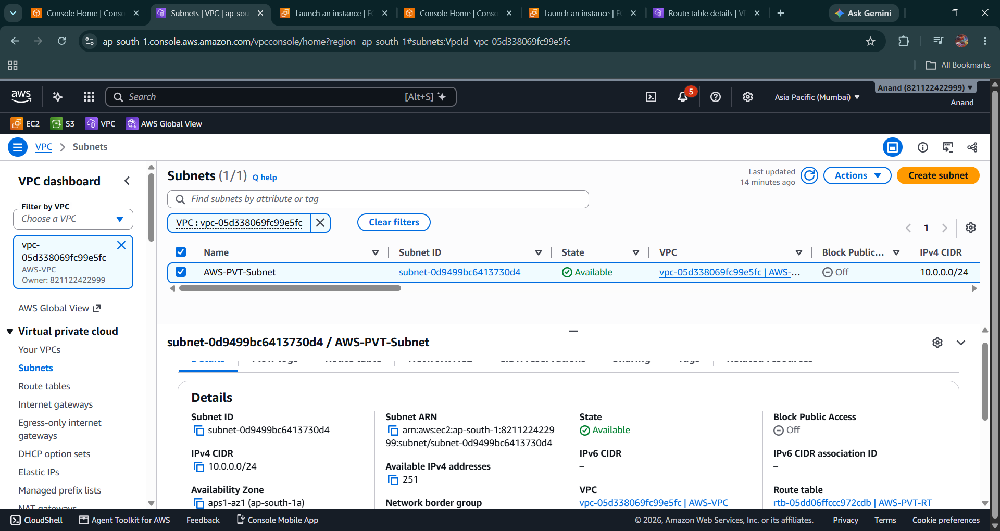
*Figure 2. Private workload subnet.*

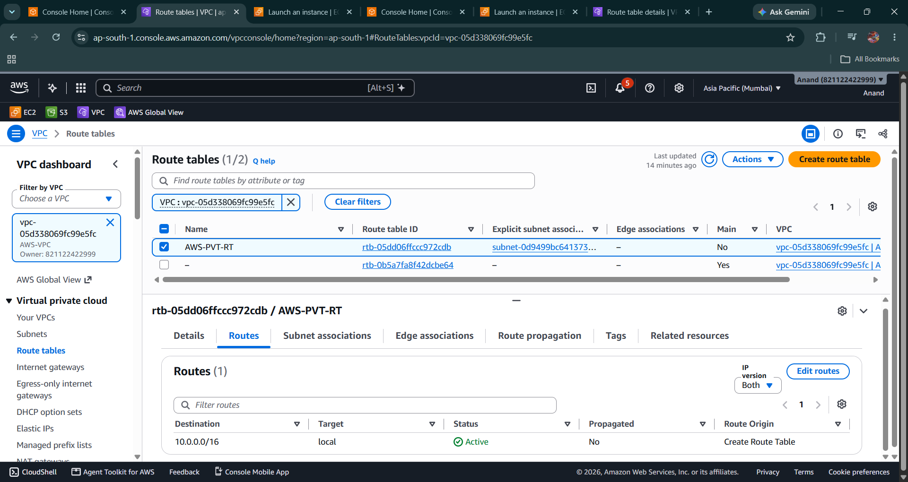
*Figure 3. The workload subnet route table. Add the remote datacenter route after creating the VPN (Step 6).*

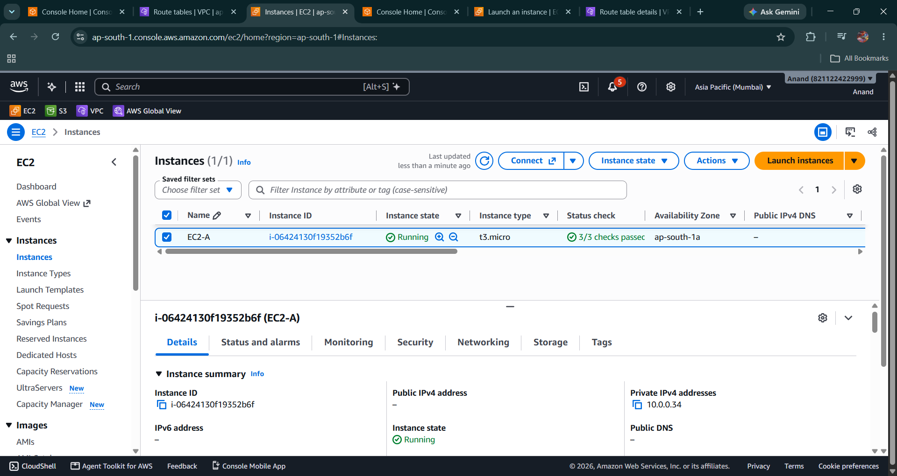
*Figure 4. EC2-A is a private test host in the workload subnet.*

### 2. Create the simulated datacenter VPC (N. Virginia)

Switch to **US East (N. Virginia), `us-east-1`**. This second VPC stands in for an on-premises network; it is still hosted in AWS.

1. Create `DC-VPC` with CIDR `192.168.0.0/16`.
2. Create a public subnet (example `192.168.0.0/24`) for the VPN router and a private subnet (example `192.168.100.0/24`) for EC2-B.
3. Create and attach an Internet Gateway. Associate a public route table with the public subnet and add `0.0.0.0/0` to the Internet Gateway.
4. Create a private route table and associate it with the private subnet. Its route to `10.0.0.0/16` will be added in Step 6.
5. Launch the VPN router EC2 in the public subnet. Assign a stable public address (prefer an Elastic IP) and allow the necessary IPsec traffic from the AWS VPN tunnel endpoints: UDP `500`, UDP `4500`, and IP protocol `50` (ESP) when applicable. Restrict administrative SSH to your own IP.
6. Launch EC2-B in the private subnet with no public IP. Permit test traffic from `10.0.0.0/16` in its security group.

AWS security groups allow IP protocol rules; ESP is protocol 50, not a TCP/UDP port. Do not open SSH or ICMP to `0.0.0.0/0` for convenience.

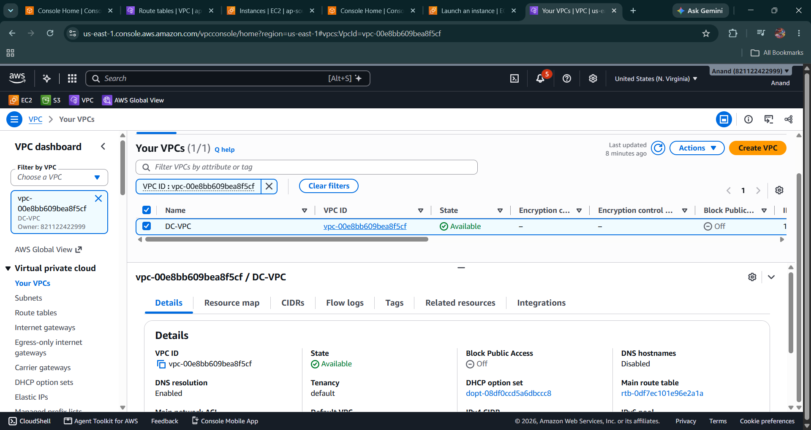
*Figure 5. Simulated datacenter VPC.*

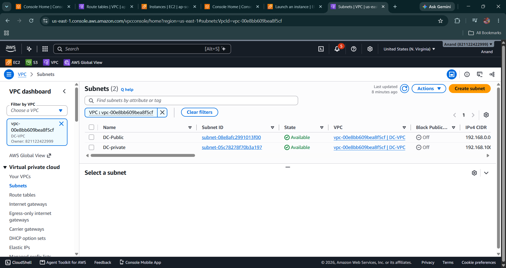
*Figure 6. Public and private subnets in the customer-side VPC.*

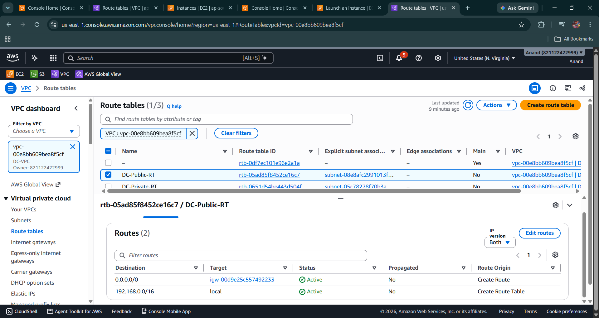
*Figure 7. Public subnet default route through the Internet Gateway.*

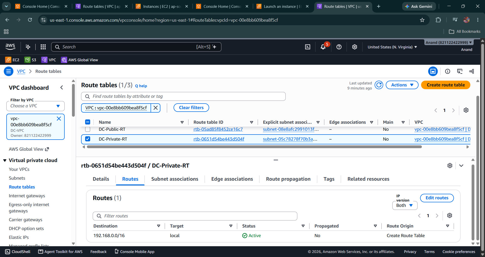
*Figure 8. Private route table before adding the AWS workload route.*

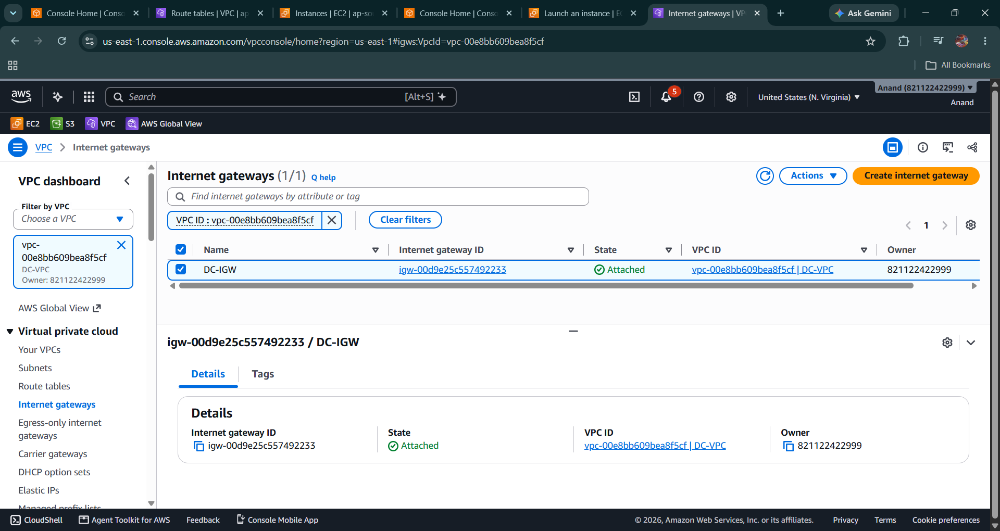
*Figure 9. Internet Gateway attached to the simulated datacenter VPC.*

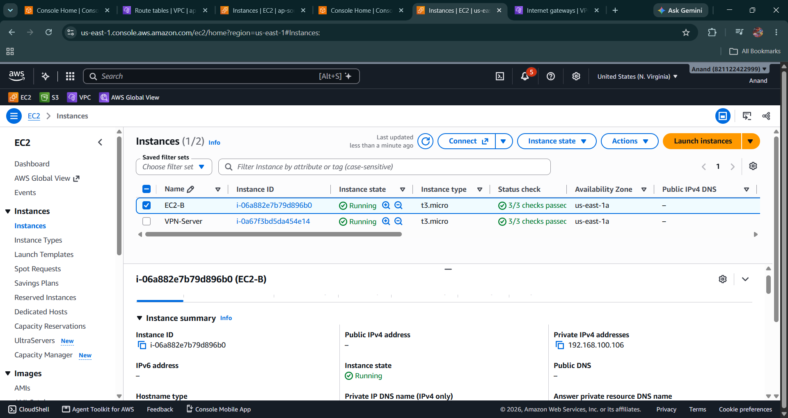
*Figure 10. EC2-B is the private customer-side test host.*

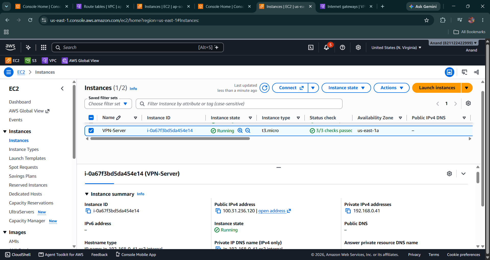
*Figure 11. The VPN router runs in the public subnet and forwards traffic between the VPN and VPC.*

### 3. Configure the VPN router for packet forwarding

Connect to the VPN router and disable EC2 source/destination checks. The router forwards packets whose source or destination is not its own address, so this EC2 check must be disabled.

```bash
# Amazon Linux 2023
sudo dnf install -y libreswan

# Enable IPv4 forwarding and disable reverse-path filtering
sudo tee /etc/sysctl.d/99-vpn-router.conf >/dev/null <<'EOF'
net.ipv4.ip_forward = 1
net.ipv4.conf.default.rp_filter = 0
net.ipv4.conf.default.accept_source_route = 0
EOF
sudo sysctl --system
```

In **EC2 → Instances → VPN router → Actions → Networking → Change source/destination check**, choose **Stop**. Alternatively, using AWS CLI with your instance ID and region:

```bash
aws ec2 modify-instance-attribute \
  --instance-id i-REPLACE_WITH_ROUTER_INSTANCE_ID \
  --no-source-dest-check \
  --region us-east-1
```

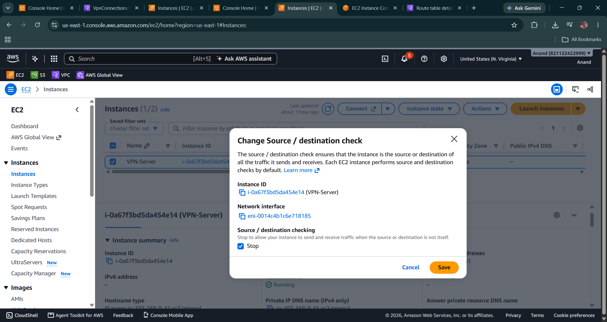
*Figure 12. Source/destination checking is disabled on the forwarding instance.*

Verify forwarding and install Libreswan:

```bash
sysctl net.ipv4.ip_forward
ipsec --version
```

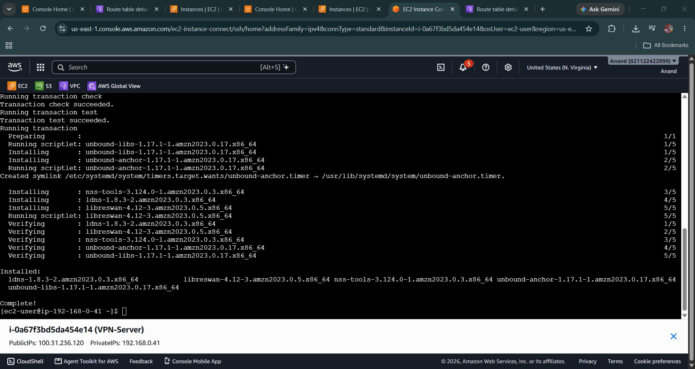
*Figure 13. Libreswan installed on Amazon Linux 2023.*

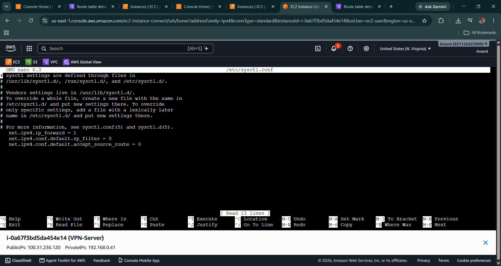
*Figure 14. Kernel forwarding and routing-related sysctl settings.*

### 4. Create the AWS VPN resources

In **Mumbai (`ap-south-1`)**, create these resources from **VPC → Site-to-Site VPN**:

1. Create a **Virtual Private Gateway**; name it `AWS-network-vgw`, then attach it to `AWS-VPC`.
2. Create a **Customer Gateway**; select **Static**, and enter the VPN router's stable public IPv4 address. Set the BGP ASN only if prompted; this lab uses static routes, not BGP.
3. Create a **Site-to-Site VPN connection** with the virtual private gateway and customer gateway. Select **Static** routing and add the customer-side network `192.168.0.0/16` as the static IPv4 prefix.
4. Wait for the connection to become **Available**. Download its configuration for Libreswan or a compatible vendor profile. Use the tunnel endpoint, inside CIDR, proposal, and pre-shared key values generated for *your* VPN connection.

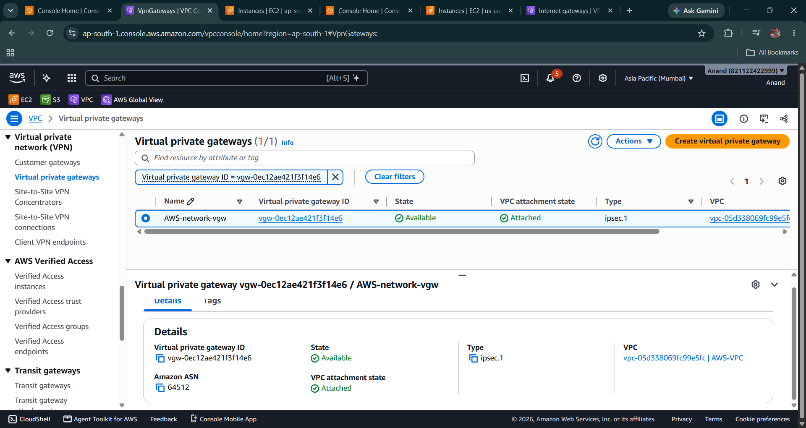
*Figure 15. Virtual private gateway attached to the Mumbai VPC.*

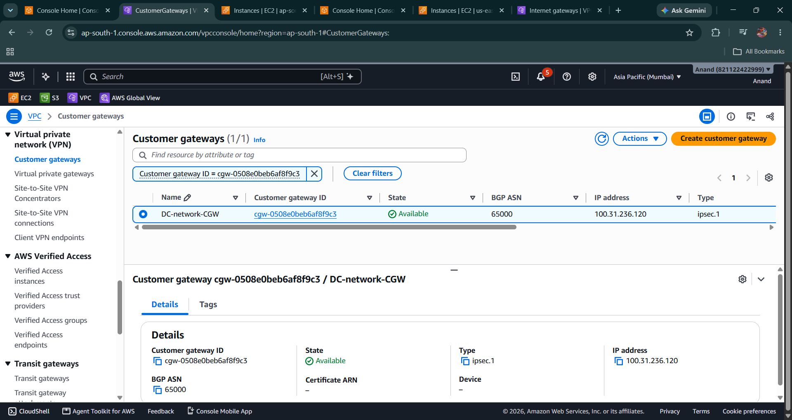
*Figure 16. Customer gateway points to the VPN router's public address.*

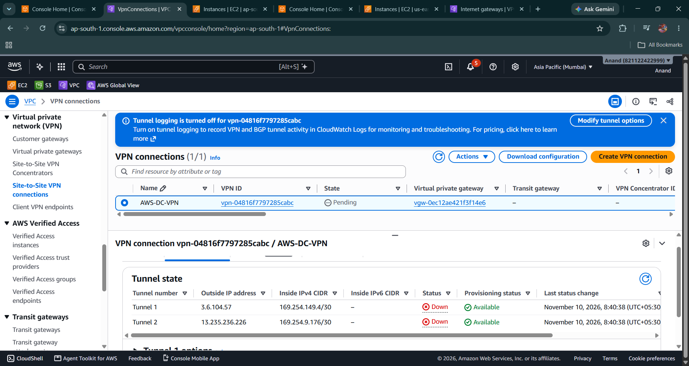
*Figure 17. VPN connection and tunnel state. In the captured lab Tunnel 1 is Up; Tunnel 2 is Down.*

### 5. Configure Libreswan with the downloaded tunnel parameters

AWS provides two tunnels. Configure each independently if you want redundancy. This exercise configured Tunnel 1. Copy parameters from the downloaded AWS configuration; never reuse the example endpoint addresses or keys in another account.

Edit `/etc/ipsec.d/aws.conf`. The values below illustrate the shape only; replace all endpoint and network values with those from your VPN download and VPCs:

```conf
conn Tunnel1
    authby=secret
    auto=start
    left=%defaultroute
    leftid=<VPN_ROUTER_PUBLIC_IP>
    right=<AWS_TUNNEL_1_OUTSIDE_IP>
    type=tunnel
    ikev2=insist
    ikelifetime=8h
    salifetime=1h
    phase2alg=aes128-sha256
    ike=aes128-sha256;modp2048
    keyingtries=%forever
    keyexchange=ike
    leftsubnet=192.168.0.0/16
    rightsubnet=10.0.0.0/16
    dpddelay=10
    dpdtimeout=30
    dpdaction=restart_by_peer
```

Some AWS generated profiles use version-specific Libreswan syntax. Follow the downloaded profile's syntax and proposal values when they differ from this example. Set the pre-shared key in `/etc/ipsec.secrets` with the router public IP and AWS tunnel endpoint as required by the downloaded profile. Protect the file:

```bash
sudo chmod 600 /etc/ipsec.secrets
sudo systemctl enable --now ipsec
sudo systemctl status ipsec --no-pager
sudo ipsec status
sudo ipsec trafficstatus
```

Do **not** commit `/etc/ipsec.secrets`, the downloaded VPN configuration, or any real pre-shared key. Add secret files to `.gitignore` if you copy them into this project directory.

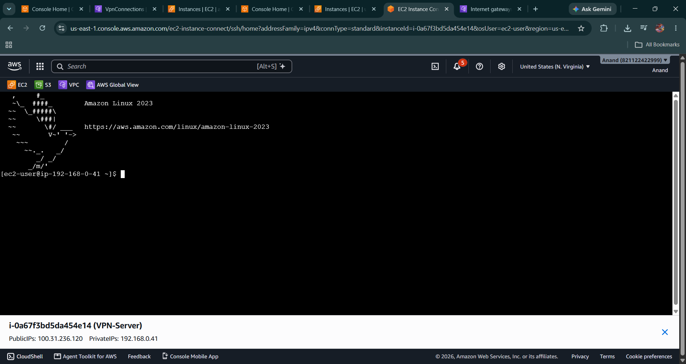
*Figure 18. Connected to the Libreswan router to configure the tunnel.*

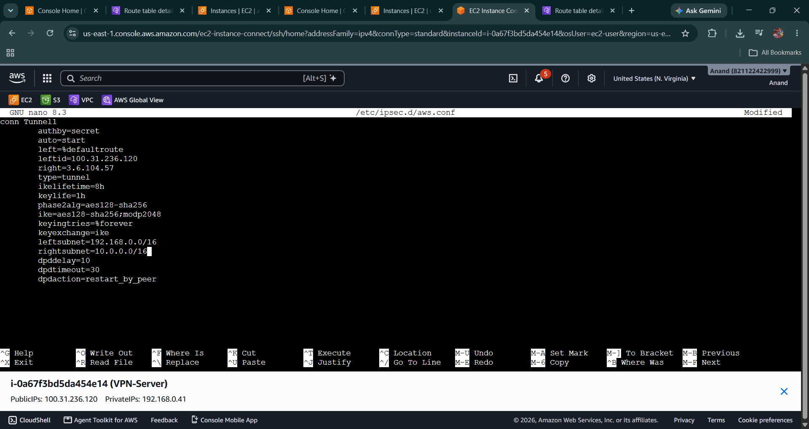
*Figure 19. Tunnel 1 connection profile. Replace the real endpoint and CIDR values for your environment.*

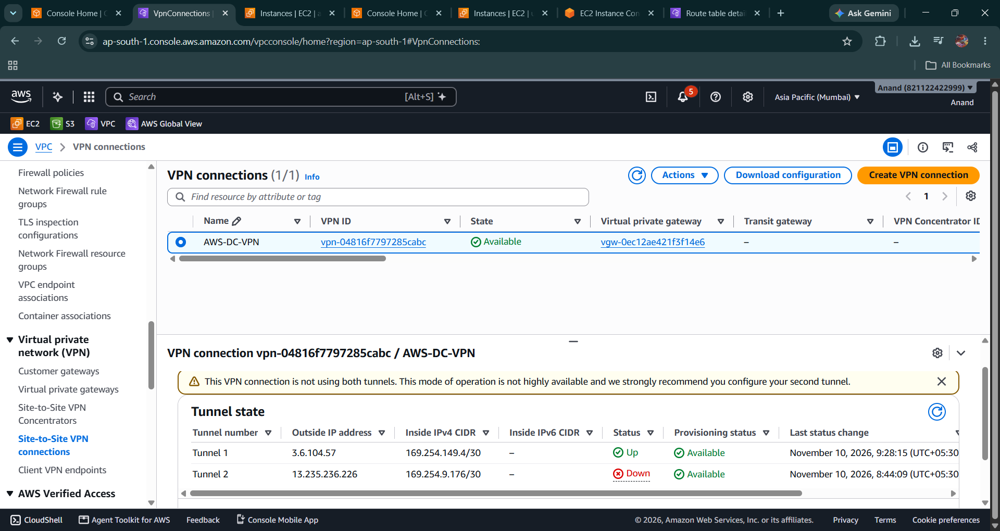
*Figure 20. AWS reports Tunnel 1 Up. Tunnel 2 remained Down in this single-tunnel exercise.*

### 6. Add routes on both sides

A tunnel can be Up while workloads still cannot communicate; each subnet route table needs a route to the remote CIDR.

- **Mumbai AWS private route table:** add destination `192.168.0.0/16` with target the Virtual Private Gateway (`vgw-...`).
- **N. Virginia simulated datacenter private route table:** add destination `10.0.0.0/16` with target the VPN router EC2 network interface (or the supported instance target presented in the console). Ensure the private subnet's return path points to the router.
- Enable route propagation on the AWS VPC route table if using propagated routes; with static VPN routes, verify that the route appears and is active.

Do not point the datacenter private route at the Internet Gateway. Traffic for the remote AWS CIDR must pass through the Libreswan router.

### 7. Validate private connectivity

Allow ICMP between the two private CIDRs in both workload security groups for the test. Also check network ACLs and host firewalls. Use private addresses; no public internet path should be involved in these tests.

From EC2-A in Mumbai:

```bash
ping -c 4 192.168.100.106
```

From EC2-B in the simulated datacenter:

```bash
ping -c 4 10.0.0.34
```

If testing SSH from the router to EC2-B, use the private key securely available on the router, with restrictive permissions:

```bash
chmod 400 key.pem
ssh -i key.pem ec2-user@192.168.100.106
```

For Amazon Linux, the default SSH user is commonly `ec2-user`; verify the AMI's user. Do not place private keys in Git or in shell history. Prefer Session Manager or a managed key distribution approach in production.

```bash
# On the router, inspect the tunnel and routes
sudo ipsec status
ip route
sudo journalctl -u ipsec --since "15 minutes ago" --no-pager
```

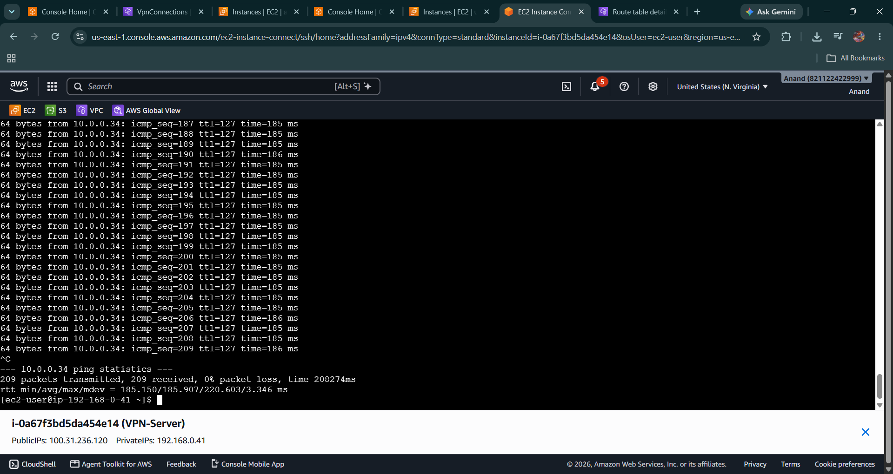
*Figure 21. Ping replies from the AWS private host (`10.0.0.34`).*

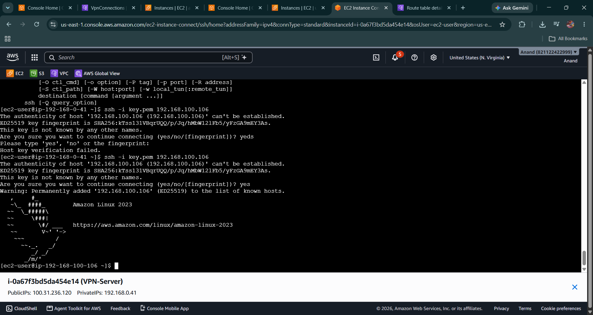
*Figure 22. SSH session to the private datacenter test host over the VPN.*

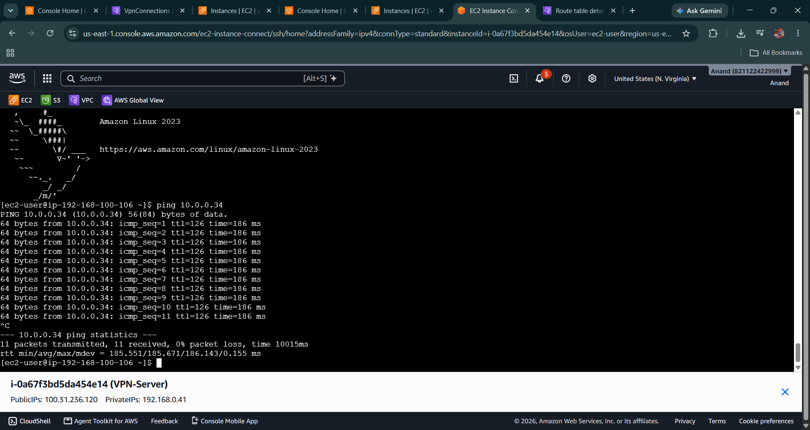
*Figure 23. EC2-B receives replies from EC2-A across the IPsec connection (0% loss in the captured sample).*

## Troubleshooting checklist

1. **Tunnel Down:** confirm router public address matches the Customer Gateway; allow UDP 500/4500 and ESP as required; compare IKE/IPsec proposals and pre-shared key against the AWS downloaded profile; check `sudo journalctl -u ipsec`.
2. **Tunnel Up, no traffic:** verify both route tables, static VPN prefix, subnet associations, source/destination check, IP forwarding, and security groups/NACLs.
3. **One-way traffic:** confirm the remote route and return route exist on both sides and host firewalls permit the test protocol.
4. **Router forwards but packets drop:** check `net.ipv4.ip_forward=1`, `rp_filter=0`, the EC2 source/destination check, and host firewalls.
5. **Tunnel flaps:** compare lifetime, DPD, IKE, and IPsec settings to the downloaded AWS profile; inspect service logs and network reachability.
6. **Tunnel 2 Down:** expected if only Tunnel 1 is configured. A production setup should configure and test both AWS tunnels and monitor failover.

## Security and cleanup

- Treat VPN configuration downloads and pre-shared keys as secrets. Keep secrets outside the repository and rotate them if exposed.
- The screenshots show AWS account and resource identifiers and public addresses from the original lab. Review and redact these in your own copy before making the repository public.
- Restrict router administration, IPsec, and workload rules to required sources and protocols.
- When finished, terminate the EC2 instances and remove the VPN connection, detach and delete the virtual private gateway, delete the customer gateway, then delete subnets, route tables, Internet Gateway, and VPCs. Confirm dependencies in the console before deleting.

## Screenshots

The screenshots are arranged in build order under [`images/`](images/). Each image above has a short caption explaining what it demonstrates. Replace these with sanitized screenshots if publishing this repository publicly.

## Notes

This is a learning lab, not a production reference architecture. The customer network is simulated in a second AWS Region, and the recorded VPN used only one active tunnel. For production, use a real customer gateway endpoint, configure both VPN tunnels, implement monitoring and failover tests, and review AWS security and availability requirements.
